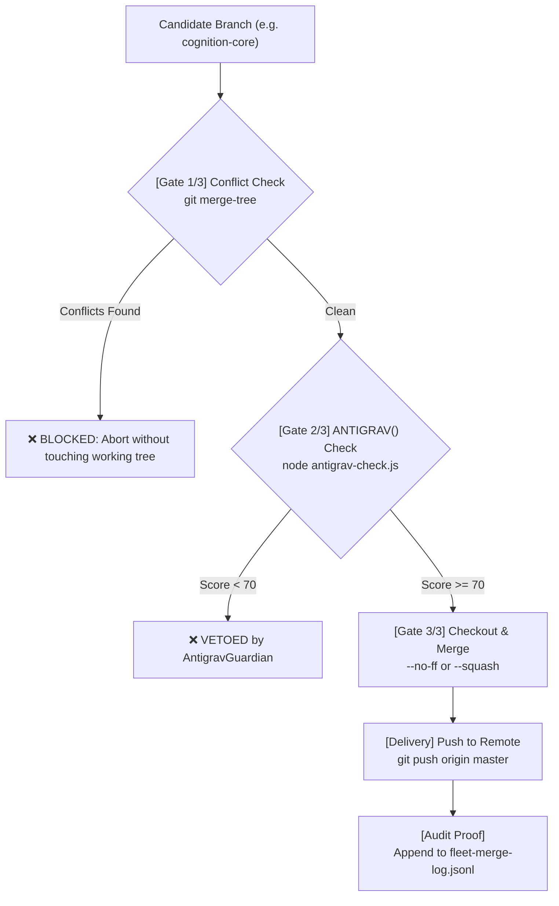

# Git Fleet Pusher & Merge Acceptance Engine

Automates multi-branch synchronization, pending change staging and pushes, Jules/Fleet automated Pull Request queue audits, and **ANTIGRAV-gated Merge Acceptance**.

## Overview
This skill provides production-grade CLI automation for:
1. **Pushing all local branches**: Synchronizing all branches (`cad-engine`, `simulation-core`, `unreal-bridge`, `cognition-core`, `master`) to the remote repository.
2. **Pushing pending local changes**: Staging tracked modified/deleted files, committing with conventional messages, and pushing upstream.
3. **Merge Acceptance Engine**: Validating candidate branches against strict merge-conflict pre-flights, checking ANTIGRAV sovereign quality scores (>= 70), executing merges, and pushing the accepted target branch upstream.
4. **Fleet / Jules Sentinel Batch Integration**: Parsing [fleet-pr-audit-summary.md](file:///c:/Users/Shane/Documents/dev/PrimordiaOS/fleet-pr-audit-summary.md) for approved branches (e.g. `jules-pr-29`, `jules-pr-28`) and processing merge acceptance automatically.
5. **Traceable Proof Logging**: Recording all merge acceptance events and SHAs into `fleet-merge-log.jsonl`.

## Dependencies
- `git` (CLI on PATH)
- PowerShell 7+ or Windows PowerShell 5.1
- `node` (for `antigrav-check.js`)
- Optional: `gh` (GitHub CLI) for PR dispatch (`winget install --id GitHub.cli`)

## The 3-Gate Merge Acceptance Architecture

Whenever a branch is submitted for merge acceptance into `master`:



---

## Quick Start & Utility Commands

The core engine is located at [scripts/git-fleet.ps1](file:///c:/Users/Shane/Documents/dev/PrimordiaOS/.agents/skills/git-fleet-pusher/scripts/git-fleet.ps1).

### 1. Merge Acceptance for a Specific Branch
Validates conflict-freedom and ANTIGRAV score, merges the source branch into `master`, and pushes upstream:
```powershell
pwsh .agents/skills/git-fleet-pusher/scripts/git-fleet.ps1 -Action AcceptMerge -SourceBranch "cognition-core" -TargetBranch "master"
```

#### With Squash Merge:
```powershell
pwsh .agents/skills/git-fleet-pusher/scripts/git-fleet.ps1 -Action AcceptMerge -SourceBranch "cognition-core" -TargetBranch "master" -Squash
```

### 2. Batch Merge Acceptance for All Approved Fleet PRs
Scans [fleet-pr-audit-summary.md](file:///c:/Users/Shane/Documents/dev/PrimordiaOS/fleet-pr-audit-summary.md) for approved branches (`score >= 70`), tests each, merges them into `master`, and pushes:
```powershell
pwsh .agents/skills/git-fleet-pusher/scripts/git-fleet.ps1 -Action AcceptAllApproved -TargetBranch "master"
```

### 3. Push All Local Branches and Tags
Pushes all branches (`cad-engine`, `simulation-core`, `unreal-bridge`, `cognition-core`, `master`) to the remote:
```powershell
pwsh .agents/skills/git-fleet-pusher/scripts/git-fleet.ps1 -Action PushAll
```

### 4. Stage Tracked Files, Commit & Push Current Branch
```powershell
pwsh .agents/skills/git-fleet-pusher/scripts/git-fleet.ps1 -Action PushPending -Message "feat: synchronize core engine"
```

### 5. Inspect Branch Status & Upstreams
```powershell
pwsh .agents/skills/git-fleet-pusher/scripts/git-fleet.ps1 -Action Status
```

---

## Proof & Audit Logs

Every accepted merge generates an immutable entry in `fleet-merge-log.jsonl`:
```json
{
  "timestamp": "2026-09-10T10:58:00.000Z",
  "action": "MERGE_ACCEPTANCE",
  "source": "cognition-core",
  "target": "master",
  "headSha": "ad0bd65a9...",
  "squash": false,
  "status": "ACCEPTED"
}
```

## Common Pitfalls & Guardrails
- **Uncommitted Changes**: Merge Acceptance will intentionally abort if unstaged modifications exist in the working directory to prevent dirty merge conflicts. Run `-Action PushPending` first.
- **Remote 403 Errors**: Ensure your Git Credential Manager or active SSH key has write access to the target repository. If pushing to your personal fork, verify `git remote -v`.
