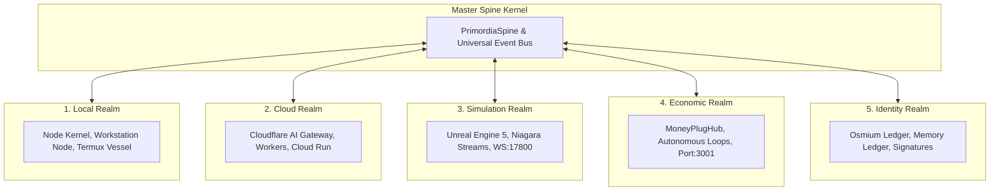

# PrimordiaOS Architecture: Unified Multi-Realm Cognition Organism

## 1. Executive Summary

PrimordiaOS is architected as a continuous, unified multi-realm cognition organism. Rather than disparate, disconnected repositories and scripts, PrimordiaOS integrates all computation, simulation, monetization, and cryptographic verification into a single coherent master spine.

---

## 2. Sovereignty-Governed Multi-Agent Hierarchy

| Tier | Entity | Role | Sovereignty Level | Powers |
|---|---|---|---|---|
| **0** | **Human Sovereign (Shane)** | Final authority, approval, and veto | **Absolute** | Overrides constraints, approves realms, sets thresholds |
| **1** | **Primordia Sovereignty Kernel** | Master Spine, event broker, state bus | **Supreme** | Orchestrates coherence, routes pulses, enforces ANTIGRAV |
| **2** | **Guardian Agents (AntigravGuardian)** | Integrity protection & sovereignty audit | **High** | Vetoes low-scoring changes (< 70), prevents passive collapse |
| **3** | **Domain Agents (RealmBuilder, LoopEngineer, etc.)** | Domain operations & pipeline execution | **Medium** | Builds realms, maintains autonomous loops, manages edge infra |
| **4** | **Utility Agents** | Narrow-scope execution & runners | **Low** | Tests, scans, doc generation, telemetry logging |

---

## 3. The 5 Continuous Realms

1. **Local Realm (`realms/local/`)**:
   - Workstation host and Android/Termux mobile node.
   - Core runtime, CLI runner, and process supervision.
2. **Cloud Realm (`realms/cloud/`)**:
   - Cloudflare AI Gateway for unified edge inference.
   - Cloudflare Workers and Google Cloud Run for serverless APIs and public tunneling.
3. **Simulation Realm (`realms/simulation/`)**:
   - Unreal Engine 5 client vessel and Niagara particle emitters (`NS_PrimordiaBigBang`).
   - Port 17800 WebSocket event server for real-time telemetry and triggers.
4. **Economic Realm (`realms/economy/`)**:
   - MoneyPlugHub monetization engine and 12-second autonomous heartbeat.
   - Affiliate conduits, syndicates, and micro-transaction routing.
5. **Identity Realm (`realms/identity/`)**:
   - Osmium SHA-256 cryptographic immutable hash-chain ledger.
   - Semantic cognitive memory ledger and sovereign signature verification.

---

## 4. Pipeline Integration & Physical Ports

- **Port 3000**: PrimordiaOS Kernel HTTP REST API, SSE Live Stream (`/api/stream`), and Cockpit HUD (`/dashboard`).
- **Port 3001**: MoneyPlugHub Full-Stack API Engine & React SPA.
- **Port 17800**: Simulation Realm WebSocket Event Server for Unreal Engine 5 & Niagara triggers.
- **Port 8888**: Pixel Streaming Server for virtual viewport streaming.
- **Edge Tunnel**: `https://moneyplughub.com` via Cloudflare Tunnel.
