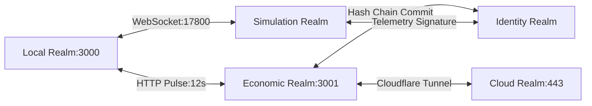

# Primordia Realm Map & Interconnection Matrix

## Realm Connection Matrix

| Source Realm | Target Realm | Protocol / Port | Primary Events | Bandwidth / Cadence |
|---|---|---|---|---|
| **Local** | **Simulation** | `ws://localhost:17800` | `BIG_BANG_TRIGGER`, `TELEMETRY_UPDATE`, `ACTION_TRIGGERED` | Real-time (2s tick) |
| **Local** | **Economic** | `http://localhost:3000` -> `:3001` | `HEARTBEAT_PULSE`, `CYCLE_COMPLETED`, `DIFF_EMITTED` | 12-second autonomous cycle |
| **Economic** | **Cloud** | HTTPS / Tunnel (`https://moneyplughub.com`) | `EDGE_DEPLOY`, `GATEWAY_INFERENCE`, `WEBHOOK_EVENT` | On-demand / edge sync |
| **Economic** | **Identity** | In-Memory Hash Chain | `LEDGER_BLOCK_COMMITTED`, `DIFF_RECORDED` | Every 12s cycle |
| **Simulation** | **Identity** | Cryptographic HMAC | `WORLD_STATE_COMMITTED`, `PHYSICS_FRAME_SIGNATURE` | Periodic verification |
