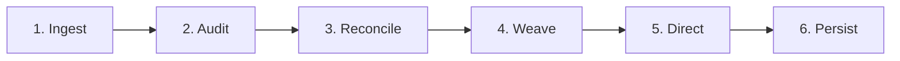

# PrimordiaOS Sovereign Control Loop Specification

## 1. Executive Overview
The **Sovereign Control Loop** is the deterministic heartbeat of PrimordiaOS, orchestrating real-time state synchronization across all seven sovereign realms:
1. **Node Kernel** (Masterplane supervisor on port `3000` / event bus on `17800`)
2. **Unreal Engine 5.4 Simulation Realm** (Niagara VFX, Pawn actors, 60fps telemetry)
3. **Antigravity Pipeline** (Google-managed DAG execution & multi-agent routing)
4. **VisionCore** (Perceptual graph & creative cognitive engine)
5. **Spatial Memory Engine** (3D vector spatial index & temporal burst clusters)
6. **Autonomous Agent Swarms** (MoneyPlugHub loops, CAD architects, faceless media)
7. **Deployment Vessels** (Docker containers & Cloud Run serverless runtimes)

---

## 2. Multi-Realm Synchronization Cadence

The loop decouples high-frequency visual/physics simulation ticks from cognitive and orchestration updates:

| Domain | Clock Rate | Transport Channel | Payload Target |
| :--- | :--- | :--- | :--- |
| **Unreal Simulation** | **60 Hz** (16.66 ms) | Binary/JSON WebSocket (`ws://localhost:17800`) | Transforms, Pawn velocities, Niagara particle collisions |
| **VisionCore Perception** | **30 Hz** (33.33 ms) | HTTP JSON stream (`http://localhost:8080`) | Perception node attention decay, anomaly flags |
| **Spatial Memory Sync** | **20 Hz** (50.0 ms) | Delta-compressed HTTP WAL | Spatial clusters, nearest-neighbor updates |
| **Sovereign Control Tick** | **1 Hz** (1000 ms) | Realm Unifier Master Heartbeat | Global worldstate reconciliation, directives dispatch |

---

## 3. Deterministic Six-Phase Execution Pipeline

Every 1000ms control tick executes a strict, sequential 6-phase state machine:



### Phase 1: Ingest (Subsystem Telemetry Harvest)
- Reads active Pawn telemetry from `UnrealRealmAdapter`.
- Collects active perception nodes and salience scores from `VisionCoreAdapter`.
- Polls system vitals (CPU, RAM, disk mutations) from Node Kernel.
- Gathers active swarm queue depth and Cloud Run container health.

### Phase 2: Audit (Origin Law & Sovereign Verification)
- Governed by subagent **SovereignGovernor** (Tier 2).
- Validates HMAC signature of `PRIMORDIA_SOVEREIGN_TOKEN`.
- Verifies compliance with `PRIMORDIAL_ORIGIN_LAW_001` (zero unauthorized telemetry egress, local-first priority).
- Evaluates `ANTIGRAV()` friction score ($\ge 70$ required; blocks automation patterns that collapse human decision-making).
- Checks circuit breaker states across all realm endpoints (max 5 consecutive failures triggers quarantine).

### Phase 3: Reconcile (WorldState Equilibrium)
- Compares aggregate metrics to determine system equilibrium:
  - `[STABLE]`: Zero background mutations, idle swarms, latency $< 20$ ms.
  - `[FLUX]`: Active code mutations, container deployments, or disk writes in progress.
  - `[CHARGED]`: Niagara bursts active, GPU warp benchmarks running, or high-throughput swarm publishing.
- Resolves spatial coordinate drift between Unreal Engine pawn transforms and Spatial Memory vectors.

### Phase 4: Weave (Telemetry Stream Harmonization)
- Governed by subagent **TelemetryWeaver** (Tier 3).
- Synchronizes disparate clock timestamps into monotonic epoch nanoseconds.
- Injects high-salience spatial events (`SPATIAL_ANOMALY`, `PROXIMITY_ENTER`) into VisionCore's cognitive graph.
- Triggers visual particle feedback for cognitive breakthroughs or state anomalies.

### Phase 5: Direct (Sovereign Directives Execution)
- Evaluates pending sovereign directives from Human Sovereign (Shane) or automated overmind routines.
- Dispatches typed payloads:
  - `niagara_pulse`: Emits Niagara particle waves (`NS_PulseWaveBurst`, `NS_PrimordiaBigBang`).
  - `pawn_teleport`: Updates sovereign pawn coordinates in Unreal simulation.
  - `swarm_spawn`: Launches specialized worker routines.
  - `vessel_scale`: Signals Cloud Run or Docker runtime.

### Phase 6: Persist (Artifact Snapshotting)
- Governed by subagent **RealmBinder** (Tier 3).
- Updates in-memory topology state.
- If topology, realm health, or worldstate changed during the cycle, commits changes to `RealmMap.json`.
- Flushes audit log to Merkle chain.

---

## 4. Sovereign Directives Interface

The control loop provides direct hooks for plain-English and structured sovereign directives:

```typescript
interface SovereignDirective {
  id: string;
  action: 'PULSE_SIMULATION' | 'SYNCHRONIZE_PAWNS' | 'SHIFT_WORLDSTATE' | 'DISPATCH_SWARM';
  targetRealm: 'simulation' | 'cognition' | 'memory' | 'agents' | 'kernel';
  parameters: Record<string, unknown>;
  originLawId: 'PRIMORDIAL_ORIGIN_LAW_001';
  timestamp: number;
}
```

Example dispatching an **Imperial Gold** Niagara wave:
```powershell
agy realm pulse --intensity 2.5 --color "Imperial Gold"
```

---

## 5. Safety Guards & Collapse Prevention

1. **Anti-Collapse Friction Threshold**: Automated posting or mutation loops must provide human cognitive review gates if `ANTIGRAV()` score falls below 70.
2. **Circuit Breakers**: If Unreal Engine or VisionCore drops connection, the loop automatically falls back to decoupled headless operation without crashing the masterplane.
3. **Deterministic Memory WAL**: All cross-realm state deltas are logged sequentially before execution to guarantee crash resilience and state reproducibility.
